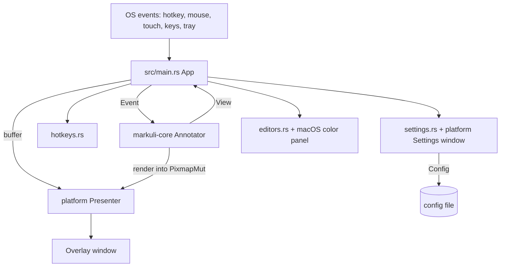
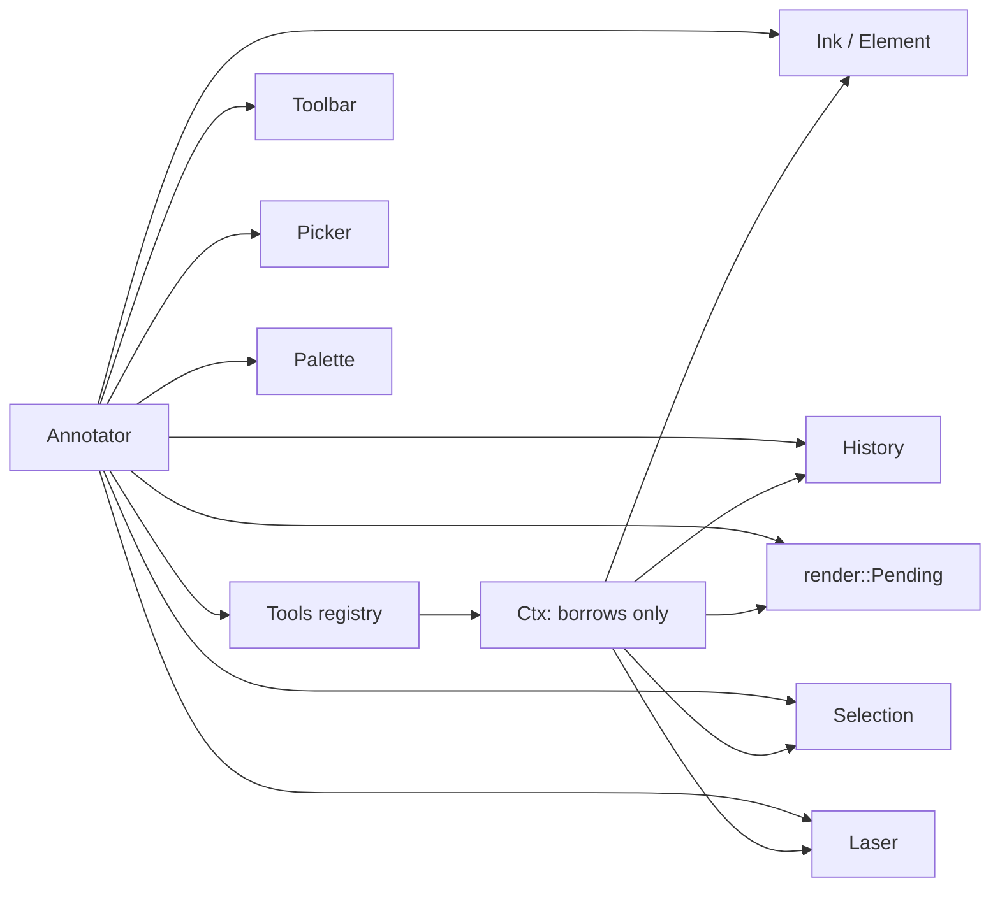
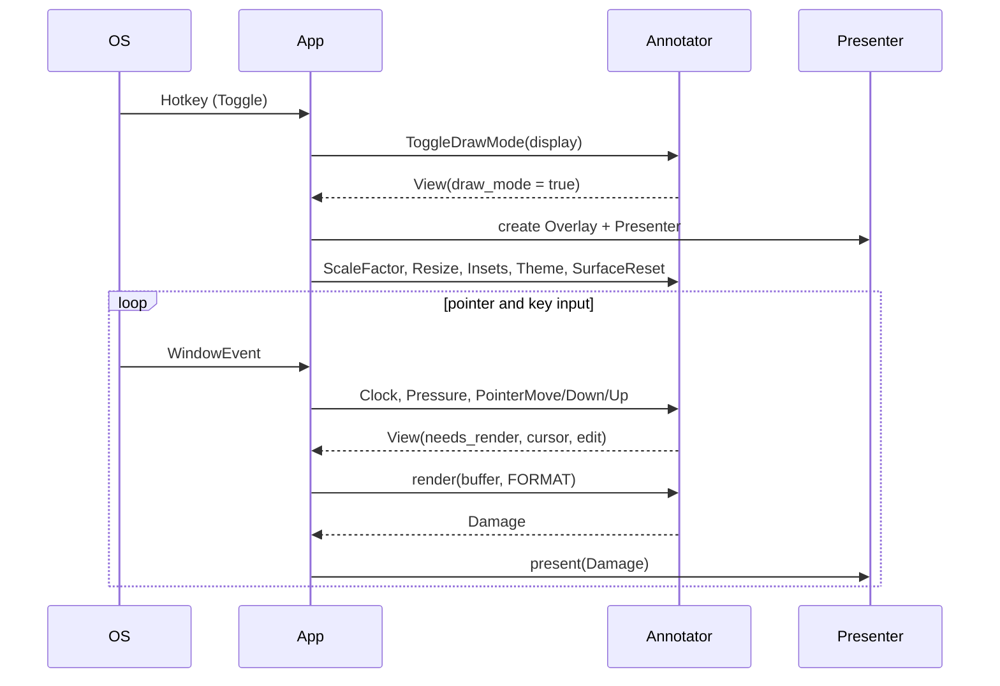

# Markuli

Markuli is a lightweight, tray-resident on-screen annotator for macOS and Windows. A global hotkey toggles **Draw Mode**: a transparent, always-on-top **Overlay** appears on the display under the cursor and the user draws freehand **Ink** whose look follows Excalidraw (perfect-freehand outlines, the Excalidraw toolbar theme, Excalidraw clipboard JSON). Leaving Draw Mode destroys the Overlay.

The codebase is split in two (see `docs/coding-standards.md` in the repo):

| Part | Location | Role |
|---|---|---|
| **Core** (`markuli-core`) | `crates/core` | Pure, platform-free logic: events in, `View` state and pixels out. |
| **Platform shell** (`markuli`) | `src/` | Event-loop glue, windows, tray, hotkeys, settings, OS-specific presentation. |

Release builds are tuned for footprint (`opt-level = "s"`, fat LTO, `panic = "abort"`, stripped; see `Cargo.toml`), and every shipped artifact must be at most 4 MB.

## Architecture

### Core: one way in

`Annotator::handle(Event) -> View` (`crates/core/src/lib.rs`) is the only input. The `Event` enum covers Draw Mode toggle, surface reset/resize/insets, scale factor, theme, pointer down/move/up, pressure, modifiers, scroll, keys, secondary click, Clear, palette/style/recent-colors restoration, system color panel edits, and `Clock`. The core owns no clock: the laser fades from `Event::Clock`, and `View::next_frame` tells the shell when to send the next one. Pixels come from `Annotator::render(target, format)`, which returns an optional `Damage` rectangle.

#### Ink and freehand
- `Element` (`ink.rs`) is one freehand stroke shaped like an Excalidraw freedraw element: points are element-local, the outline is cached (`outline`, `previous`, `bounds`, `extent`). Updating it returns the changed local box so only that is repainted.
- `freehand.rs` ports perfect-freehand's `getStroke` with Excalidraw's options. `Scratch` holds reusable buffers, so recomputing per pointer move allocates nothing once warm. `get_stroke` exists only for parity tests against `tools/fixture-gen` (`perfect-freehand` 1.2.0, `@excalidraw/laser-pointer` 1.3.1).
- `Ink` is the in-memory element list, including eraser marking (`mark_near`, `unmark`, `take_marked`).
- `excalidraw.rs` writes the clipboard JSON by hand (no serde). `Num` guards non-finite floats; `Index` produces fractional z-indices.

#### Tools
`Tool` (`tools/mod.rs`) is a trait; adding a tool means one new type plus one line in `Tools::new`. Tools receive a `Ctx` of mutable borrows, never the `Annotator`.

| Tool | Keys | Behaviour |
|---|---|---|
| `Select` | V | Click, shift-click, drag box, drag-to-move (3 px threshold), Delete. `Gesture` is `Idle`, `Moving` or `Boxing`. |
| `Pen` | P, 7 | One stroke per press; P/7 again swaps to Eraser. Esc cancels the stroke. |
| `Eraser` | E, 0 | Marks elements near the sampled drag path (faded to 1/5 opacity), removes them on release as one undo step. |
| `LaserTool` | K | Drives the fading trail; never touches Ink or history. |
| `Hand` | H (or Alt-drag) | Changes the Scroll only. |

`Cursor` and `ToolKind` are the types the shell sees. The shell draws the cursor images in `src/cursor.rs` (`Image`, `Canvas`), rebuilt only when the cursor or scale changes.

#### History
`History` (`history.rs`) is an operation log, not snapshots. Each `Op` (`Add`, `Clear`, `Move`, `Delete`, `Erase`, `Restyle`) stores only its payload, and `flip` swaps it with the Ink in the `Direction::Apply` or `Revert` direction. Undo is exact because moves and restyles store the value the element is *not* at, so there is no float drift. A new operation truncates the redo branch.

#### Laser
`laser.rs` ports `@excalidraw/laser-pointer` (`Pointer`, `Trail`, `Laser`), using `libm` so corner-arc vertex counts match V8's fdlibm. All trails are filled in one path so overlaps do not darken. `Laser::next_frame` returns a value only while a trail is visible, so the loop sleeps afterwards.

#### Palette, style, config
- `Palette` holds 5 color slots and 3 width slots (widths in pt, snapped to 0.25, clamped 0.5 to 30). `Style` stores chosen slot indices; `Appearance` is a `Style` resolved to rgb and width. `Choice` encodes color, width, thinner and bolder picks. `RecentColors` is a six-entry, newest-first, `Copy` list.
- `Config` (`config.rs`) parses and writes a plain `key=value` file (hotkeys as text, launch at login, style, toolbar position, palette version 3, recent colors). Damaged lines are skipped, and older palette versions are migrated or reset.

#### Toolbar
The toolbar module (`toolbar/`) is split into state and hit-testing (`mod.rs`), geometry (`layout.rs`), painting (`paint.rs`) and theme tokens (`theme.rs`).
- `Layout` recomputes four islands (Tools, colors, widths, actions) from the Overlay size, scale, OS `Insets` and `ToolbarPosition` on every use. A side column that does not fit falls back to the top row.
- `Area` is the shared rectangle type (`contains`, `intersects`, `grow`, `union`).
- `Toolbar` tracks hover and press. `Look` and `UiState` snapshot what was last painted, so `is_dirty` is a plain comparison. `Chrome` bundles the toolbar for one render pass.
- `Theme` (Light or Dark) maps to Excalidraw `Tokens`; shadows are stacked translucent rounded rectangles.

#### Color Picker and Width Picker
`picker/` draws one popover next to a palette slot. `Picker` holds only small state (open slot, tab, hover, drag, hue); geometry is never stored.
- `layout.rs`: `Geometry::place` positions the popover on the `Side` facing away from the toolbar edge, clamped inside the usable Overlay, and `rect_of` yields the rectangle of each `Part`. `hit` and `fraction` serve hit testing and drag mapping.
- `color.rs`: `Hsv`, WCAG contrast (`is_low` warning badge), neutrals and 9x4 Open-color presets.
- `custom.rs`: `Custom` and `Picture` cache the saturation/value square and the hue strip as pixel buffers, refilled only when hue, size or channel order changes, and freed when Draw Mode ends.
- `paint.rs`: `Glyphs` (icons parsed once) and `Brush` do the painting.
- `Outcome` is all the picker emits (`Pick`, `Tab`, `Set`, `Reset`, `More`, `Inert`); the router applies it to the palette, the Selection and recent colors. "..." makes `View::edit` carry an `EditRequest`, and the shell opens the system color panel.
- `Popover` and `Look` plug the picker into the renderer's damage tracking.

#### Rendering
`render.rs` composes incrementally (standards rules 7 and 8):
1. `Pending` accumulates a dirty rectangle (or a full redraw) and owns the Scroll and scratch buffers.
2. The toolbar and popover are never painted incrementally: if they change, or other damage touches them, their whole region is redrawn from backdrop and Ink, so shadows never stack.
3. Damage is split into bands of at most 1 MiB. `compose_band` paints every layer (backdrop, Ink, Laser, Selection, toolbar, popover) into a reused scratch pixmap and copies the finished band into the target in one pass. The compositor therefore never sees a half-painted frame (ADR-0003).
4. In Draw Mode the backdrop is alpha 1 (nearly invisible) so the OS does not pass clicks through to apps below.

`Painter` wraps the scratch pixmap and shares one `PathBuilder` across shapes. `icons.rs` and `svg_path.rs` render Excalidraw's SVG icons with a small hand-written path parser. `Format` selects RGBA or BGRA, and the platform picks BGRA so no conversion pass is needed.

### Platform shell

`src/main.rs` (`App`) turns OS events into core `Event`s and the returned `View` into window calls.

Key responsibilities:
- **Overlay lifetime**: the Overlay exists only in Draw Mode and is created on the display under the cursor. `display_id` hashes position, size and scale, so a changed display clears the Ink (ADR-0002). Memory is returned with `release_memory` on exit.
- **Platform layer** (`src/platform/`): per-OS `Presenter`, cursor `Shape`, `Previous` (focus hand-back), monitor lookup, OS `insets`, pen pressure, clipboard, launch at login and config directory.
  - **macOS** (`macos.rs`): Accessory app, `CALayer` showing a locked `IOSurface` that the core draws into directly. It uses `setContentsChanged` when available, otherwise double-buffers two surfaces. Launch at login writes a LaunchAgent plist.
  - **Windows** (`windows.rs`): layered window fed by a top-down BGRA DIB through `UpdateLayeredWindowIndirect`, presenting only the damaged rectangle. Launch at login writes `HKCU\...\Run\Markuli`. Pens arrive as touch events with force. The file notes it is compile-checked on CI but not yet run on real hardware.
- **Hotkeys** (`hotkeys.rs`): `Hotkeys<R: Registrar>` registers the Toggle and Clear combos (defaults `alt+Backquote` and `alt+Digit1`), rebinds with the new combo registered before the old one is released, and is suspended while the Settings recorder listens. `RebindError` is `Invalid`, `UsedByOther` or `Taken`. A key table maps W3C key names to macOS and Windows codes, and `recorded` rejects bare non-function keys.
- **Settings** (`settings.rs`): `SettingsEvent` flows through a `OnceLock` sink to the event loop. The window is `macos_settings.rs` (an `NSWindow` subclass that is its own target and recorder) or `windows_settings.rs` (a Win32 window plus `windows_recorder.rs`). The config file lives under the platform config directory.
- **System color panel** (`editors.rs`, `macos_editors/`): non-modal `NSColorPanel` raised above the Overlay, reporting `EditorEvent::Color` and `Closed { generation }`. The generation counter discards stale close notices.
- **Event loop**: `about_to_wait` sets `WaitUntil` from `View::next_frame`, otherwise `Wait`, so the app is idle when nothing animates. Tray menu items are Settings and Quit.

The `dev-hooks` feature enables test overrides (`MARKULI_CONFIG_DIR`, `MARKULI_LAUNCH_AGENT_DIR`, `MARKULI_OPEN_SETTINGS`, `MARKULI_PRESENT_FALLBACK`); release builds do not read them. The core's `test-support` feature exposes locators (`button_center`, `picker_point`) for tests and is enabled only through a dev-dependency.

## Build, CI and release

| Artifact | Purpose |
|---|---|
| `Cargo.toml`, `crates/core/Cargo.toml` | Workspace of `markuli` and `markuli-core`; pedantic clippy; platform-specific dependencies (`objc2-*` on macOS, `windows-sys` on Windows). The core depends only on `libm` and `tiny-skia`. |
| `rust-toolchain.toml` | Pins the toolchain with rustfmt and clippy and the Windows MSVC and macOS x86_64 targets. |
| `.github/workflows/ci.yml` | On macOS and Windows runners: `cargo fmt --check`, `cargo clippy -D warnings`, `cargo test --workspace`. |
| `.github/workflows/release.yml` | A `v*` tag builds the macOS dmg and Windows zip, then `publish` creates a GitHub Release with generated notes. Artifacts are unsigned and there is no auto-updater. |
| `scripts/package-macos.sh` | Builds arm64 and x86_64, `lipo`s a universal binary, writes `Info.plist` (`LSUIElement`), ad-hoc signs it, creates the dmg, and fails above 4 MB. |
| `scripts/package-windows.ps1` | Builds `x86_64-pc-windows-msvc`, zips `Markuli.exe`, and fails above 4 MB. |
| `tools/fixture-gen/package.json` | Dev-only generator of golden fixtures for Rust parity tests; never shipped. |

## Design principles visible in the code
- **Core/platform split**: the core has no OS dependencies, so it is fully testable with a fake event stream and an in-memory pixmap.
- **Event-driven only**: no polling; time enters as `Event::Clock`.
- **Derived, not stored, geometry**: toolbar and picker layouts are recomputed from current size, scale, insets and position, so they are never stale.
- **Damage-based repaint** with a state snapshot (`Look`) compared against what was last painted.
- **Allocation discipline**: reused scratch buffers, `Copy` value types, and buffers freed when Draw Mode ends.
- **Fidelity to Excalidraw**: outlines, laser trail, toolbar tokens, selection look and clipboard JSON are ports; deviations are documented in each file's header.
